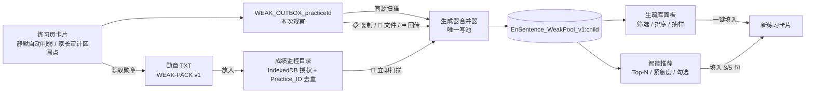

# En_Sentence_HTML · 英语阅读练习生成器 V2.8（同伴抢答 + 起手式布局 + 成绩监控）

一键把"英文句子 + 中文翻译"生成可在线朗读的 **单文件 HTML** 练习页。  
所有卡片统一为「中文 → 可选同伴抢答 → 左起手式 + 右整句展开」骨架：孩子先辨析同伴说的句子，再选定句首起手式，点右侧槽位让整句淡入并朗读。

**v2.8 新增 🎭 同伴抢答接力（Peer Relay）**：随机一位同伴（👦 小明 / 🐻 小熊 / 🐸 青蛙 / 👧 玲玲）抢答句子。被标记的句子 100% 由同伴说错，孩子点出错误意群；普通句子每份练习随机抽 0~2 张，由同伴说对，孩子点「👍 这句没问题！」。旧版放大镜 / 单字找茬 / 搜查机会已彻底移除。

**v2.8 新增 ✨ AI 智能生成（生成器端）**：在生成器顶部配置 OpenAI 兼容的 API（默认智谱 GLM），每张录入卡片点「✨ AI 智能生成」，即可根据中文一次生成 2~3 个正确表达 / 起手式，并按需生成同伴错句、3~4 个错误意群胶囊与温和讲解。API Key 只存本机 `localStorage`，不会进入下载的练习页。

**v2.2 新增 🔁 生疏句循环复习**：练习页静默自动判弱，家长在页面底部「家长审计」区补标 → 第二天生成器一键滚入复习 → 连续 2 次快速通过自动毕业。

**v2.5 新增 🎧 播放状态自愈**：朗读按钮不再只等 TTS 的 `end` 事件——心跳看门狗兜底、点读打断保护、报错/切句安全收尾，彻底告别「读完了还卡在播放中」。

**v2.6 新增 📂 成绩反馈监控目录 + 🎯 智能推荐复习**：选定一次成绩文件夹即可自动扫描勋章 TXT / 错题包（IndexedDB 记住授权，按 Practice_ID 去重），并按遗忘曲线、失败次数、手动红标、毕业观察期给出 Top-N 推荐，一键或自由勾选填入复习。第二天备课只需 3 次点击。

**v2.7 保留 🚀 起手式布局**：所有卡片「左侧起手式 + 右侧整句展开」，中文直接清晰展示，认知启动更轻。

无需服务器、无需安装，拖到浏览器就能用；  
也支持 GitHub Pages 直接发布，手机/平板/电脑秒开。

---

## 1. 怎么用（3 步 + 每日复习）
1. 用浏览器打开 `index.html`（需要本地 HTTP 服务器，见下方说明）
2. 填写日期 → 逐条输入英文句子 & 中文翻译（可按钮排序、可插说明框）→ 设置熟练度阈值
   - 可选：展开顶部 **"⚙️ AI 助手配置"**，填写 API Base URL / API Key / 模型，点「🔌 测试连接」；之后每张卡片可点 **"✨ AI 智能生成"**，自动填入正确表达、多个起手式与同伴错句（勾选「同时生成同伴抢答错句」时）。
   - 可选：勾选 **"🎭 让同伴抢答时说错这句"**，填写正确的英文对照文本（以及可选的错误讲解），系统会自动生成意群胶囊与错误定位
3. 点 **"生成练习网页"** → **"下载HTML文件"**
   把下好的 `.html` 发给孩子，或直接把文件拖到浏览器即可开始练习。
4. （跨天复习）第 5 节「📂 设定/切换成绩目录」选定存放勋章 TXT 的文件夹 → 每天把新勋章放进去 → 点「🔄 立即扫描更新」→「🎯 填入推荐 5 句」→ 再生成。详见第 3 节；不支持目录授权的浏览器可用「选择文件夹（降级）」或拖拽文件夹。

> **注意**：由于项目使用 ES Modules（`<script type="module">`），直接双击 `index.html` 在部分浏览器中会受 CORS 限制无法加载模块脚本。请使用本地 HTTP 服务器打开：
> - VS Code 插件 **Live Server**（推荐）
> - 终端命令：`python3 -m http.server` 或 `npx serve`

---

## 2. 在线演示

`https://amro01.github.io/En_Sentence_HTML/`

---

## 3. v2.8 更新内容 — 同伴抢答接力 & 统一卡片骨架

### 🎭 两阶段同伴抢答
- **阶段 1：同伴辨析**。随机一位同伴（👦 小明 / 🐻 小熊 / 🐸 青蛙 / 👧 玲玲）抢答。句子被切成 3~4 个意群胶囊，孩子点错意群或点「👍 这句没问题！」都会被温和反馈；判定通过后进入阶段 2。
  - 陷阱卡（勾选「让同伴抢答时说错这句」）：**100% 触发**，同伴说错；孩子点中错误意群才算通过。
  - 普通卡：每份练习随机抽 **0~2 张**，同伴说完全正确的句子；孩子点「👍 这句没问题！」通过。
- **阶段 2：孩子练习**。同伴气泡收起为右上角「👏 已通过」徽章，下方起手式区域从半透明静音状态亮起；孩子选开头、点「想好了？点这里」，整句淡入并朗读。
- **状态持久化**：`appState.peerResolved[cardIndex]` 记住已通过的卡片；刷新后气泡保持收起、起手式保持解锁。

### 🧩 统一 DOM 骨架
- 所有卡片共用 `buildCardHTML()`：`中文 → 可选 .peer-bubble → .start-layout → .energy-bar`。旧版陷阱卡专属模板、`data-mode` 分支、放大镜 `.detectable`、搜查机会、两击自动现形、差分解说与能量锁定全部删除。
- `data-peer-relay` 携带抢答元数据：`has_peer` / `peer_name` / `peer_avatar` / `is_peer_correct` / `chunks` / `error_chunk_index` / `error_explanation` / `correct_variants`。JSON 经 HTML 属性转义后写入，运行时不依赖外部配置。
- 陷阱卡的目标英文是家长填写的正确句；同伴说出的错句只出现在气泡胶囊里。生疏句运行时从 `data-peer-relay` 读取 `isTrap` / `trapEn`，旧的 `CONFIG.trapData` 已移除。

### 🚀 起手式布局（v2.7 保留）
- 中文直接清晰展示；句首起手式总词数 ≤ 6 取前 2 词，其余取前 3 词；标点随词保留，自动剥离 `M:` / `F：` / 中文角色名前缀，多行对话取第一行台词。
- 防刷分不变：耳机仍只在 TTS **自然读完**的瞬间点亮（`mastery_count` 只在 `commitPlaybackStats` 提交一次）。

### ✨ AI 智能生成（生成器端）
- **配置面板**：页面顶部「⚙️ AI 助手配置」支持 API Base URL、API Key（password 输入）与模型选择；默认 `https://open.bigmodel.cn/api/paas/v4` + `GLM-4.7-Flash`，可切 `GLM-4-Flash-250414` 或手动填写任意模型名。
- **只存本地**：配置写入 `localStorage.EnSentence_AI_Config`；API Key 不进入生成的 HTML，也不参与 Practice_ID。
- **测试连接**：`🔌 测试连接` 发送 `max_tokens: 1` 的最小 `/chat/completions` 请求；失败时区分 HTTP 错误、超时与浏览器 CORS 限制。
- **一键装配**：每张卡片「✨ AI 智能生成」把中文（及可选标准英文）发给模型，要求返回 2~3 个 `variants`（各带 `starter` 与风格 `tag`）和可选的 `peer_trap`（错句、3~4 个意群胶囊、错误下标、温和讲解）。
- **安全落卡**：正确表达写入目标英文；勾选「同时生成同伴抢答错句」时自动切为陷阱卡，错句写入同伴字段、正确句写入对照字段、讲解写入文本框。模型返回的 JSON 会经过围栏剥离、括号配对、字段校验与 HTML 转义，坏数据不会进入练习页。
- **多起手式**：生成页左侧会显示每颗 AI 变体胶囊；选定后右侧展示并朗读该变体，统计仍以主句为键，进度不会因切换风格而分裂。手动改过目标英文后自动退回本地起手式切分。

### 🧪 测试
- `node --test tests/*.test.js`：新增 `peer-relay`（意群切分 / 错误意群定位 / 随机 0~2 张 / AI 胶囊优先）、`card-plan`（陷阱 100% + 普通随机 / AI 元数据）、统一卡片模板、多起手式与 `ai-assistant`（配置、Prompt、JSON 容错、请求头与错误翻译）用例。

---

## 4. v2.6 更新内容 — 成绩反馈监控目录 & 智能推荐复习

### 📂 成绩反馈监控目录
- **选一次，长期用**：第 5 节「📂 设定/切换成绩目录」调用 `showDirectoryPicker()`，目录句柄存入 IndexedDB（`EnSentence_DirStore` / `monitor_dir_handle`）；刷新生成器后自动 `queryPermission` 并恢复监控，授权过期时点一次「🔄 立即扫描更新」即可重新 `requestPermission`。
- **自动解析**：递归扫描 `.txt` / `.json` / `.weakpack`，从勋章 TXT 的 `WEAK-PACK v1` 块、JSON 错题包或 base64 反馈中提取观察记录。
- **两级去重**：同一 `PracticeId` 多份反馈只保留最新导出（内容指纹兜底无 ID 文件）；已扫描的 `PracticeId` 记入 IndexedDB，跨次扫描不再重复计为「新增」。合并时仍按时间升序逐份导入，生命周期（连击/毕业）不会错乱。
- **健壮性**：旧版无错题包的 TXT、损坏 base64、空文件、超大文件逐个跳过并计数，不影响其余文件。
- **优雅降级**：不支持 File System Access API 时，用 `<input webkitdirectory>` 或直接把文件夹拖进监控区（`webkitGetAsEntry` 递归）。
- **摘要一目了然**：「已识别 N 份练习记录，发现 M 条待复习错句，最近一次反馈来自 [日期 · 孩子]」。

### 🎯 智能推荐复习
- **推荐分（0~100）**：手动红标 +50（整体置顶）、遗忘曲线到期 +20~30、失败次数 +10/次（封顶 30）、毕业观察期（连续快速通过 1 次）+15、当前生疏度 +0~10；逐项相加后钳制。
- **紧急度标识**：🔴 极度生疏 / 🟠 到期复习 / 🟡 观察中 / ⭐ 手动重点。
- **一键或自选**：`🎯 填入推荐 3 句`、`🎯 填入推荐 5 句`；`📋 批量自选复习...` 展开 Top 20，独立勾选后「➕ 将选中项填入上方卡片」。
- **范围过滤**：全量待复习 / 仅高频错题（失败 ≥2 次）/ 仅同伴错句失误（未辨析或读错）。
- **同伴配置不丢失**：原句是同伴错句时，填入复习卡片会自动回填对照英文并勾选同伴抢答。

### 🏅 勋章导出
- 文件名统一为 `YYYY-MM-DD_[孩子名]_[PracticeId]_勋章.txt`，便于监控目录稳定追踪。
- 领取勋章与家长审计区均提示：把勋章文件放入「成绩监控目录」，生成器会自动追踪复习进度。

### 家长最简流程（第二天，3 次点击）
1. 把新勋章丢进已设定的成绩监控目录；
2. 打开生成器点「🔄 立即扫描更新」；
3. 点「🎯 填入推荐 5 句」→「生成练习网页」。

---

## 5. v2.5 更新内容 — 朗读播放状态自愈

### 🎧 播放状态机重构
- **唯一出入口**：`startPlayback()` / `finishPlayback()` 统一管理按钮文案、`dataset.playing`、`disabled`、`.playing` 与 `.is-playing`；正常结束、报错、被抢占、点词打断、看门狗兜底都从同一出口解锁 UI。
- **幂等计分**：`replay` / `mastery_count` 只在「确实开播且自然读完」时提交一次；迟到或重复的 `onend` 不会重复计分，未开播、被打断、报错的朗读不计分（防刷分）。
- **看门狗兜底**：不再单一依赖 TTS 的 `end` 事件——`onstart` / `onboundary` 作为心跳刷新活跃时间，配合「启动等待 4s」「段间静默 3s」「尾音静默 1.2s」三态静默计时，以及「启动等待 + 预估时长」绝对上限，消除「朗读完了按钮还卡在播放中」的数秒悬挂（在线自然音 / 弱网下 `end` 事件偶发迟到）。
- **竞态规避**：`speechSynthesis.cancel()` 之后跨一次宏任务（`requestAnimationFrame` + `setTimeout 0`）再 `speak()`，规避 Chromium「cancel 吞掉紧随其后的 speak / 事件推迟派发」的已知问题。
- **点读打断保护**：整句朗读期间卡片进入 `.is-playing`，单词点读被 CSS 锁定；若仍被触发（键盘 / 程序化），会先安全收尾整句再朗读单词，修复旧版「点词后按钮永久卡死」。
- **异常兜底**：每一段 utterance 都绑定 `onerror` 与 `try/catch`，中间段失败立即解锁并终止剩余队列；切换卡片时旧会话被抢占收尾，不再残留播放中状态。

### 版本号
- 版本统一为 **v2.5**（`package.json` / `index.html` / 生成页页脚 / README），修正此前 dev 分支上的版本号倒置；v2.6 起再次统一为 **v2.6**。

---

## 6. v2.2 更新内容 — 生疏句循环复习

### 识别生疏句
- **自动判定**：思考超时、重听偏多、打磨不足、同伴错句未辨析，按 0–100 加权分判定（≥40 判弱）。
- **手动打标**：练习页底部「家长审计」区（默认收起，孩子端无感）勾选圆点；生成器面板的「🔴 标红 / ✅ 已掌握」。
- **手动优先**：手动红标在排序与合并中置顶；连续 2 次快速通过仍会按总规则出库。

### 数据流与架构


- 练习页把本次观察写入 `WEAK_OUTBOX_<practiceId>`（低分通过也保留，用于推进毕业）。
- 生成器「🔄 同步练习记录」扫描同源 Outbox，合并进 `EnSentence_WeakPool_v1:<孩子姓名>`。
- 跨源（如练习页是 `file://`、生成器在 `localhost`）用三种搬运方式，入口统一在练习页底部「家长审计」区（默认收起）：
  - **方式一（剪贴板）**：页面底部「家长审计」→「📋 复制错题包」→ 生成器「📥 导入错题包」粘贴；
  - **方式二（文件）**：页面底部「家长审计」→「💾 下载错题包」→ 生成器文件选择导入；
  - **方式三（回传）**：页面底部「家长审计」→「⬅️ 回传生成器」→ 打开带 `#weak=...` 的生成器，确认导入。
- 勋章 TXT 末尾附带 `WEAK-PACK v1` 机器可读块，可直接把整份 TXT 粘贴进导入框。

### 家长最简流程（第二天）
> v2.6 起推荐「📂 成绩监控目录 + 🎯 智能推荐」：把勋章放进目录 →「🔄 立即扫描更新」→「🎯 填入推荐 5 句」，见第 3 节。以下 v2.2 的同源/跨源方式仍然可用。

- **同源**：打开生成器 → 第 5 节「🔁 生疏句循环复习」→ 点「🔄 同步练习记录」→ 点「🎯 一键填入到期复习」→ 生成并下载。全程两次点击。
- **跨源（练习页是下载后的单文件）**：练习页底部「家长审计」→「📋 复制错题包」（或「💾 下载错题包」/「⬅️ 回传生成器」）→ 回到生成器展开「📥 导入错题包」→ 粘贴/选文件 → 解析导入 → 点「🎯 一键填入到期复习」。
- 孩子当天没点「领取勋章」也没关系：手动标记会立即保存；点复制/下载/回传前会先自动结算一次。
- 只要连续 2 次快速通过，句子会自动毕业；不想复习某句可在面板点「✅ 已掌握」或「🗑 删除」。

### 循环策略
- 失败间隔 1 / 2 / 4 / 7 / 14 天；到期或手动标记优先。
- 连续 2 次快速通过（分数 ≤22 且时间/重听均达标）→ 毕业，14 天后归档检查。
- 生疏池上限 300 条；配额不足时按「历史 → 毕业条目 → 最旧条目」逐级淘汰，手动标记优先保留。
- 面板支持筛选（待复习/手动/同伴错句/毕业）、排序（优先级/最久未复习/失败次数）、随机抽样与一键填入。

### 开发与测试
- 零运行时依赖；新增 `package.json` 仅用于 Node 原生测试（`"type": "module"`）。
- 运行：`npm test`（`node --test`，108 项核心/推荐/目录扫描/运行时/存储/AI/回归测试）。

存储键：

| 键 | 写入方 | 说明 |
|---|---|---|
| `STATS_<date>_<hash>` | 练习页 | 单次练习进度（原有） |
| `WEAK_OUTBOX_<practiceId>` | 练习页 | 本次观察暂存，重置不清 |
| `EnSentence_WeakPool_v1:<child>` | 生成器 | 跨日生疏池（唯一写入者） |
| `EnSentence_DirStore`（IndexedDB） | 生成器 | `monitor_dir_handle` 目录句柄 + `seen` 已扫描 Practice_ID（跨次去重） |
| `EnSentence_AI_Config` | 生成器 | AI Base URL / API Key / 模型，只存本机；不进入练习页 |

---

## 7. v2.1 更新内容 — ES Module 模块化重构

### 🏗️ 代码架构重构
- **从单文件拆分为 ES Modules**：将原来 1300+ 行的 [`script.js`](script.js) 拆解为 4 个职责清晰的模块文件
- **模板代码独立**：生成练习页的 CSS、JS、HTML 模板分别抽取为独立模块，IDE 可正常语法高亮和 lint
- **消除重复代码**：修复了原来单文件中 CSS 样式重复、字符串常量散落多处、排序按钮 HTML 重复等问题

### 📂 新文件结构
```
EnSentence/
├── index.html                 # 生成器入口页面
├── style.css                  # 生成器页面样式
├── package.json               # 仅开发期：node --test（零运行时依赖）
├── js/
│   ├── main.js                # 入口模块：卡片管理、生成/下载逻辑
│   ├── weak/
│   │   ├── weak-core.js       # 归一化/id/评分/生命周期/错题包
│   │   ├── weak-store.js      # 生疏池、Outbox 扫描、导入、配额降级
│   │   ├── weak-recommender.js# 智能推荐权重 / 紧急度 / Top-N
│   │   ├── dir-monitor.js     # 成绩目录授权持久化、扫描、解析与去重
│   │   ├── weak-panel.js      # 生成器生疏库管理面板
│   │   └── practice-id.js     # Practice_ID 纯函数（回归测试）
│   └── templates/
│       ├── generated-css.js   # 生成页面的 CSS 模板（常量导出）
│       ├── generated-html.js  # 生成页面的 HTML 组装函数
│       ├── generated-js.js    # 生成页面的 JS 构建函数
│       └── generated-weak.js  # 练习页生疏句运行时（IIFE）
├── tests/                     # Node 原生测试
└── README.md                  # 本文件
```

### ✨ 重构收益
- **可维护性提升**：每个文件职责单一，修改 CSS 样式无需在 JS 字符串中翻找
- **IDE 支持完整**：CSS 文件可正常使用自动补全、颜色预览；JS 文件可语法检查
- **构建步骤为零**：纯原生 ES Modules，无需 Webpack/Rollup，浏览器直接支持
- **功能稳定**：同伴抢答、6月亮评价、能量槽、生疏句复习等能力保持可用

---

## 8. v2.0 更新内容（历史，v2.8 已被同伴抢答替代）

### 🕵️ 旧侦探挑战模式 (Detective Challenge Mode)
> v2.8 起本节机制全部移除：不再有放大镜、举报、搜查机会、两击自动现形、能量锁定或差分解说。故意错句改由「🎭 同伴抢答」承载，孩子通过点击错误意群帮助同伴。
- 陷阱句系统、点击举报、未抓获锁定能量、两击自动现形、搜查机会、可视化差分解说与侦探荣誉均已删除。

### v1.12 & v1.13 历史更新 🌙 极致评价体系 (The Mastery Scale)
- **全面重写 `calculateStars()`**，新增 6 月亮阶梯评价：
  - 🌙🌙🌙🌙🌙🌙 **6枚紫金闪耀月亮 (Extreme Speed Master)**：
    所有句子均在 `timeThreshold × 50%` 时间内完成，且重听次数 ≤ 1 次。
    显示 6 个 🌙 图标（带紫色霓虹脉冲动画）；v2.6 起勋章统一命名为 `YYYY-MM-DD_孩子名_PracticeId_勋章.txt`（星级/月亮写入报告正文）
    专属文案："🚀 超越时空的极速大师！你已经形成了英语反射弧！"
  - ⭐⭐⭐⭐⭐ **5颗黄金星 (Perfect Focus)**：所有句子在规定时间内完成，且重听次数为 0
  - ⭐⭐⭐⭐ **4颗星 (Good Effort)**：所有句子在规定时间内完成，但存在重听记录
  - ⭐⭐⭐ 及以下：沿用原有比例逻辑
- **历史侦探加成（v2.8 已移除）**：旧版报告曾额外标注"超级侦探"。

### 🧹 重新挑战功能 (The Reset Button)
- 在"领取勋章"按钮下方新增淡灰色按钮："🧹 清空记录，重新挑战最高评价"
- 点击弹出温馨确认框："宝贝，准备好清空记录，重新冲击 6 枚月亮了吗？"
- 确认后执行 `localStorage.removeItem()` + `location.reload()`，一切重置为初始状态

### ✨ CSS 动效升级
- 🌙 6月亮新增 `@keyframes pulse` 持续柔和紫色霓虹发光动画
- 重置按钮使用 `#b0bec5` 淡灰蓝色背景，与粉色高亮"领取勋章"按钮明显区分
- 动效：`shake`（同伴气泡温和纠错）、`overlayFadeIn`（遮罩渐入）、`hint-msg`（浮动提示）

### v1.1 历史更新
- **动态星级算法**：根据思考时间和重听次数自动评星（1-5星 + 6月亮极致评价）
- **勋章报告**：一键生成感性 TXT 报告，包含红榜、挑战榜、原始数据、金耳朵成就
- **领取仪式**：Confetti 纸屑动画 + 星级面板弹出 + 自动下载 TXT 文件
- **命名空间隔离**：每个练习文件生成唯一 `Practice_ID`，localStorage 互不干扰

---

## 9. 特色
- 默认 **0.7 倍速**、优先选 **Microsoft Ava** 等高质量朗读声
- 支持 **说明框**（可写提示、语法点，支持基础 HTML 标签）
- **按钮排序**：精准控制卡片顺序，无拖拽冲突
- **交互锁死**：必须先看中文思考，才能解锁英文按钮
- **智能统计**：思考时间取所有 session 中的最大值，练习次数跨刷新累加
- **命名空间隔离**：不同练习页的进度互不覆盖
- **星级/月亮勋章系统**：完成练习后自动评星/评月，下载感性报告存入成就文件夹
- **能量槽系统**：每完整听完一次朗读点亮一个小耳机，满 3 个金色边框
- **播放状态自愈**：按钮解锁不单一依赖 TTS 的 `end` 事件，`onboundary` 心跳 + 预估时长看门狗兜底；点词打断、段落报错、切换句子都会正确收尾，杜绝「朗读完了按钮还卡在播放中」
- **极致评价体系**：6 月亮需要 50% 时间阈值 + 低重听，挑战最高极限
- **重置挑战**：可一键清空记录，重新冲击最高评价
- **🎭 同伴抢答接力**：随机同伴（👦 小明 / 🐻 小熊 / 🐸 青蛙 / 👧 玲玲）抢答；陷阱卡 100% 说错、普通卡随机 0~2 张说对；意群胶囊 + 温和纠错 + 阶段 2 解锁
- **🧩 统一卡片骨架**：所有卡片共用中文 → 同伴气泡 → 起手式 → 能量槽结构，无旧侦探分支
- **📂 成绩反馈监控目录**：目录授权持久化、递归扫描勋章/错题包、Practice_ID + 内容指纹去重、拖拽降级
- **🎯 智能推荐复习**：加权推荐分、四种紧急度、Top-3/5 一键填入、批量自选、同伴错句配置自动回填
- **纯前端，ES Modules 模块化架构**，无构建步骤，浏览器原生支持
- **响应式布局**，手机/平板体验友好

---

## 10. 已知小 Bug
| 描述 | 优先级 | 状态 |
|---|---|---|
| 暂无已知问题 | - | ✅ 已修复 |

---

## 11. 下一步计划
- [x] 修复"滑动选词"冲突：已改用按钮排序方式
- [x] 交互锁死：必须先点中文才能解锁英文按钮
- [x] 数据追踪与家长管理面板
- [x] 星级勋章系统：动态评星、感性报告、领取仪式 (v1.1)
- [x] 能量槽 & 金耳朵成就 (v1.12)
- [x] 极致评价体系（6月亮）+ 重置挑战 (v1.13)
- [x] ~~🕵️ 侦探挑战模式~~：v2.8 已由「同伴抢答接力」替代，旧放大镜链路删除 (v2.0 → v2.8)
- [x] **ES Module 模块化重构**：从单文件拆分为模块化架构 (v2.1)
- [x] **🔁 生疏句循环复习**：自动/手动判弱、Outbox 跨日流转、错题包导入、连续 2 次毕业 (v2.2)
- [x] **🎧 播放状态自愈**：令牌式播放状态机 + 心跳看门狗兜底 + 点读打断保护 (v2.5)
- [x] **📂 成绩反馈监控目录 + 🎯 智能推荐复习**：IndexedDB 目录授权、批量解析去重、加权推荐与一键填入 (v2.6)
- [x] **🚀 起手式布局**：左起手式 + 右整句展开 (v2.7)
- [x] **🎭 同伴抢答接力 + 统一卡片骨架**：陷阱 100%、普通随机 0~2 张、意群胶囊、两阶段解锁 (v2.8)
- [ ] 积分墙 HTML：复用成绩监控目录，汇总总星数并显示离兑换奖励的距离

---

## 12. 文件说明
```
EnSentence/
├── index.html                 # 生成器入口（双击需本地 HTTP 服务器）
├── style.css                  # 生成器页面样式
├── package.json               # 仅开发期：node --test
├── js/
│   ├── main.js                # 入口模块：表单收集、AI 卡片装配、生成/下载逻辑
│   ├── ai-assistant.js        # AI 配置 / Prompt / JSON 容错 / chat/completions 请求
│   ├── card-plan.js           # 卡片计划：同伴分配 + 练习卡 HTML 组装（纯函数）
│   ├── peer-relay.js          # 意群切分 / 错误定位 / 随机 0~2 张（纯函数）
│   ├── starter.js             # 句首起手式切分（纯函数）
│   ├── weak/                  # 生疏句核心/存储/推荐/目录监控/面板/Practice_ID
│   └── templates/
│       ├── card-html.js       # 所有卡片共用的统一 DOM 骨架
│       ├── generated-css.js   # 生成页面的 CSS 模板
│       ├── generated-html.js  # 生成页面的 HTML 组装
│       ├── generated-js.js    # 生成页面的 JS 构建函数
│       └── generated-weak.js  # 练习页生疏句运行时
├── tests/                     # Node 原生测试
└── README.md                  # 本文件
```

---

## 13. 技术栈
HTML + CSS + Vanilla JS (ES Modules)，零依赖，零构建步骤。

浏览器原生支持 `<script type="module">`，无需 Webpack / Rollup / Vite。

---

## 14. 贡献 & 反馈
Issue / PR 都欢迎！
欢迎提出新功能建议或报告问题~
