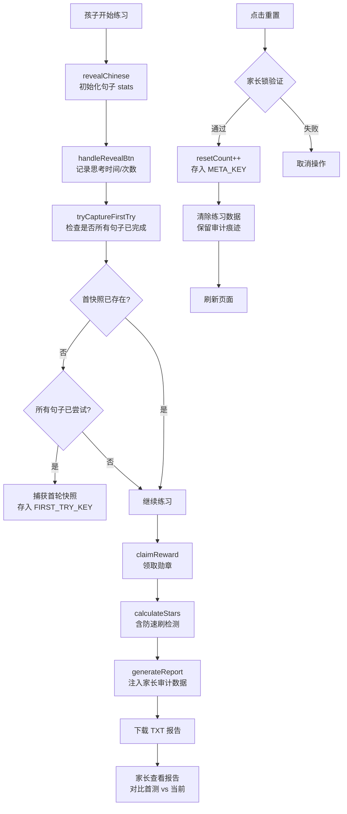

# 英语阅读练习生成器 — 防作弊/刷分漏洞修复方案

## 1. 漏洞分析报告 (Vulnerability Analysis)

### 漏洞 A: "重置刷分" (Reset-and-Speedrun)

**严重性**: 🔴 高
**文件**: [`js/templates/generated-js.js`](js/templates/generated-js.js:884)
**当前代码**:
```js
function resetChallenge() {
    if (confirm('...')) {
        localStorage.removeItem(CONFIG.practiceId);
        location.reload();
    }
}
```
**攻击路径**: 孩子先正常练习多轮背诵答案 → 点击"🧹 清空记录" → localStorage 被完全清空 → 凭借记忆在极短时间内完成所有句子 → 自动满足 `allWithinHalfTime && maxReplay <= 1` 条件 → 获得 6 月亮评价。
**根因**: `resetChallenge()` 无条件清除所有数据，且系统没有记录重置次数和首次尝试成绩。没有任何"历史痕迹"留存。

---

### 漏洞 B: "多标签页/源码窥探" (Multi-tab / Source Code Peeking)

**严重性**: 🔴 高
**攻击路径**: 生成的 HTML 中英文原文通过 `data-english` 属性和 `.english` 区域直接存在于 DOM 中。孩子可以在另一个标签页打开同一 HTML，或按 F12 打开 DevTools → Elements 面板 → 直接读取 `data-english` 属性值。
**根因**: 纯前端单文件 HTML 的固有限制。英文文本必须存在于 DOM/源码中供朗读和比对。**此漏洞无法完全根除**，只能通过家长审计机制让家长察觉异常。

---

### 漏洞 C: "刷新避错" (Refresh-to-Avoid-Bad-Data)

**严重性**: 🟡 中
**攻击路径**: 孩子遇到不会的句子或超时时，手动刷新页面。`revealChinese()` 只在该句子被首次点击时创建 stats 记录。如果孩子遇到难题直接刷新，该句子可能从未被记录（因为 `revealChinese` 未触发），或只有不完整的数据。
**根因**: `saveAppState()` 是增量保存，但刷新前的未完成操作数据可能丢失。刷新后 `loadAppState()` 加载的是上次保存的状态。

---

### 漏洞 D: "浏览器控制台篡改" (Console Manipulation)

**严重性**: 🟡 中
**攻击路径**: 孩子可以在 DevTools Console 中：
1. 直接调用 `claimReward()` 领取勋章（无需完成练习）
2. 直接修改 localStorage：`localStorage.setItem(CONFIG.practiceId, '{"stats":{"...篡改数据..."}')`
3. 删除指定句子的 bad stats 条目
**根因**: 所有函数暴露在全局作用域，localStorage 可被任意读写。

---

### 漏洞 E: "语速欺诈" (Speed Manipulation)

**严重性**: 🟢 低
**攻击路径**: 将语速调到最快 (1.5x) → 短句可能在极短时间内读完 → `replay` 计数不受影响但 `time` 值极小。
**根因**: `sessionStartTime` 在 `revealChinese()` 中设置，`handleRevealBtn()` 用 `Date.now() - sessionStartTime` 计算思考时间。如果朗读速度很快，思考时间看似很短。

---

### 漏洞 F: "局部重置" (Selective Data Wipe via DevTools)

**严重性**: 🟡 中
**攻击路径**: 不点"清空记录"，而是直接在 DevTools 中编辑 localStorage，将某个特定句子的 `time` 改为 0，`replay` 改为 0。这样其他句子的好成绩保留，只有这个句子的坏成绩被抹除。
**根因**: localStorage 的可编辑性。

---

### 漏洞 G: "未完成所有句子即领奖"

**严重性**: 🟢 低
**当前代码**: `claimReward()` 中只检查 `result.total === 0` 和未捕获的陷阱，但**不检查是否所有卡片都已尝试**。如果孩子只做了 5 句中的 3 句（且这 3 句完美），也能获得高评价。
**根因**: `calculateStars()` 基于 `Object.keys(stats).length` 作为总数，没有与 DOM 中的实际卡片数做比对。

---

## 2. 解决方案设计 (Solution Design)

### 设计原则
1. **零后端依赖** — 所有方案使用纯前端 localStorage，离线可用
2. **多层防御** — 不是堵死所有路，而是让"刷分"行为无处遁形
3. **保护孩子成就感** — 不剥夺 6 月亮的获得，但让家长能辨别真假
4. **渐进增强** — 不破坏现有功能，向后兼容

---

### 机制 1: 首次尝试快照 (First-Attempt Snapshot)

#### 存储架构

引入两个独立于 `CONFIG.practiceId` 的 localStorage 键：

```
FIRST_TRY_KEY = 'FTS_' + practiceId  (示例: 'FTS_STATS_20260315_a1b2c3')
META_KEY      = 'META_' + practiceId (示例: 'META_STATS_20260315_a1b2c3')
```

`resetChallenge()` 只删除 `CONFIG.practiceId`，**不删除**这两个键。

#### 数据防篡改弱混淆

所有写入 `FIRST_TRY_KEY` 和 `META_KEY` 的值在存储前进行 Base64 编码：
```js
// 编码写入
function encodeForStorage(obj) {
    return btoa(unescape(encodeURIComponent(JSON.stringify(obj))));
}
// 解码读取
function decodeFromStorage(str) {
    return JSON.parse(decodeURIComponent(escape(atob(str))));
}
```
这样可以防止孩子通过 F12 → Application 面板直接看懂并篡改首测快照和重置次数。

#### 首次快照数据结构

```js
firstTrySnapshot = {
    status: "complete" | "incomplete",     // 完成状态
    timestamp: "2026-03-15T10:30:00.000Z", // 捕获时间
    starRating: 3,                          // 首次尝试的星级
    avgThinkTime: 12.5,                     // 首轮平均思考时间（秒）
    totalReplay: 4,                         // 首轮总重听次数
    totalSentences: 5,                      // 总句子数
    attemptedSentences: 3,                  // 已尝试的句子数（incomplete 时有用）
    stats: { /* 首次完成的逐句 stats 副本 */ }
}
```

`status: "incomplete"` 表示快照是在首轮未完成时因重置被迫捕获的。

#### 捕获时机

**正常捕获** — 在 `handleRevealBtn()` 每次更新 stats 后，调用 `tryCaptureFirstTry()`：
- 检查 `FIRST_TRY_KEY` 是否已存在 → 若已存在则跳过
- 检查是否所有 DOM 卡片都已有 `stats` 记录且 `count >= 1`
- 若条件满足，深拷贝当前 stats 并计算星级，写入 `FIRST_TRY_KEY`，`status` 设为 `"complete"`

**强制捕获（半途重置）** — 在 `resetChallenge()` 中，如果快照尚未存在：
- 强制深拷贝当前已有的所有 stats（即使尚未完成所有句子）
- 写入 `FIRST_TRY_KEY`，`status` 设为 `"incomplete"`
- 在家长审计报告中显示："⚠️ 首测未完成（中途重置），仅记录了部分句子的数据"
- 防止策略：孩子无法通过"做错就重置"来刷出一个完美的首次尝试记录

#### 重置行为变化

```js
function resetChallenge() {
    // [新增] 家长锁验证...

    // [新增] 半途重置强制捕获
    if (!loadFirstTrySnapshot()) {
        forceCapturePartialFirstTry(); // 强制捕获当前不完整数据
    }
    
    // [新增] 增加重置计数器
    meta.resetCount++;
    saveMetaData(meta);
    
    // 只清除练习数据，保留 FIRST_TRY_KEY 和 META_KEY
    localStorage.removeItem(CONFIG.practiceId);
    location.reload();
}
```

---

### 机制 2: 家长审计痕迹 (Audit Trail)

#### 元数据 (META_KEY)

```js
metaData = {
    resetCount: 3,              // 重置次数
    firstCreatedAt: "2026-03-15T10:00:00.000Z",  // 首次创建时间
    lastResetAt: "2026-03-15T11:00:00.000Z"      // 上次重置时间
}
```

#### 报告中注入审计数据

在 `generateReport()` 末尾注入：

```
--- 家长审计数据 (不会被重置清除) ---
📋 首轮测试数据（首次完整练习的真实记录）：
   首测时间: 2026年-03月-15日
   首测星级: ⭐⭐⭐ (3星)
   首测平均思考时间: 12.5秒
   首测总重听次数: 4次
🔄 重置次数: 3 次
⚠️ 当前评价为 6月亮 (紫金闪耀)，首测仅为 3 星且经历了 3 次重置。
   提示家长：本次高评价可能来源于反复练习后的熟练表现，
   请综合首测数据评估孩子真实的句子掌握程度。
```

---

### 机制 3: 异常行为检测 (Anti-Speedrun)

#### 检测逻辑

在 `calculateStars()` 中新增：

```js
// 防速刷检测
let hasSpeedrunFlag = false;
let speedrunSentences = [];

for (let key in stats) {
    if (stats[key].time < 0.5) {  // 思考时间 < 0.5秒
        hasSpeedrunFlag = true;
        speedrunSentences.push(key);
    }
}

// 6月亮额外条件: 所有句子思考时间 >= 1.0秒（防止背诵后秒过）
if (stars === 6) {
    for (let key in stats) {
        if (stats[key].time < 1.0) {
            stars = 5;  // 降级为 5 星
            break;
        }
    }
}
```

#### 报告标记

在生成报告中，如果 `hasSpeedrunFlag`：
```
⚠️ 异常检测：以下句子思考时间 < 0.5秒，存在快速跳过嫌疑：
   "What is your name?" (0.2秒)
```

---

### 机制 4: 家长暗号/简单锁 (Parent Lock)

#### Generator 端新增设置

在 [`index.html`](index.html:48) 的"判定标准与评价设置"区域新增：

```html
<label>
    <input type="checkbox" id="enableParentLock" checked>
    🔒 启用家长锁（重置需数学验证）
</label>
<label>
    <input type="text" id="parentPasscode" placeholder="可选：自定义密码">
    🔑 家长管理密码（可选，留空则使用数学题验证）
</label>
```

#### 重置时的验证流程

```js
function resetChallenge() {
    // 家长锁验证
    if (CONFIG.parentLockEnabled) {
        if (CONFIG.parentPasscode) {
            // 密码模式
            const pwd = prompt('🔒 请输入家长密码以执行重置：');
            if (pwd !== CONFIG.parentPasscode) {
                alert('密码错误，操作已取消。');
                return;
            }
        } else {
            // 数学题模式
            const a = Math.floor(Math.random() * 90) + 10;
            const b = Math.floor(Math.random() * 90) + 10;
            const answer = prompt(`🔒 家长验证：${a} + ${b} = ?`);
            if (parseInt(answer) !== a + b) {
                alert('验证码错误，操作已取消。');
                return;
            }
        }
    }
    // ... 后续重置逻辑 ...
}
```

#### Hard Reset（彻底清除所有数据）

硬重置按钮不隐藏，而是放在页面最底部，采用低调的灰色小字样式。点击时强制触发家长锁验证。

```html
<!-- 放在页面底部，灰色小字 -->
<div style="margin-top:30px;text-align:center;font-size:0.75em;color:#ccc;">
    <a href="#" onclick="hardReset();return false;" style="color:#ddd;text-decoration:none;">
        ⚠️ 彻底清除所有记录（含审计数据）
    </a>
</div>
```

```js
function hardReset() {
    // 强制触发家长锁验证
    if (!verifyParentLock('hardReset')) return;
    
    if (confirm('⚠️ 此操作将清除包括家长审计数据在内的所有记录！\n确定要继续吗？此操作不可撤销！')) {
        localStorage.removeItem(CONFIG.practiceId);
        localStorage.removeItem(getFirstTryKey());
        localStorage.removeItem(getMetaKey());
        location.reload();
    }
}
```

#### 统一的家长锁验证函数

```js
function verifyParentLock(context) {
    if (!CONFIG.parentLockEnabled) return true;
    
    if (CONFIG.parentPasscode) {
        // 密码模式
        const pwd = prompt('🔒 请输入家长密码' +
            (context === 'hardReset' ? '以执行彻底清除' : '以执行重置') + '：');
        if (pwd !== CONFIG.parentPasscode) {
            alert('密码错误，操作已取消。');
            return false;
        }
    } else {
        // 数学题模式
        const a = Math.floor(Math.random() * 90) + 10;
        const b = Math.floor(Math.random() * 90) + 10;
        const answer = prompt('🔒 家长验证：' + a + ' + ' + b + ' = ?' +
            (context === 'hardReset' ? ' （验证后将执行彻底清除）' : ''));
        if (parseInt(answer) !== a + b) {
            alert('验证码错误，操作已取消。');
            return false;
        }
    }
    return true;
}
```

---

## 3. 文件修改清单 (File-by-File Changes)

### 文件 1: [`js/templates/generated-js.js`](js/templates/generated-js.js)

这是**核心修改文件**，需要变更以下函数/区域：

| # | 区域 | 变更类型 | 说明 |
|---|------|---------|------|
| 1 | CONFIG 对象 (行 16-25) | 修改 | 新增 `parentLockEnabled`, `parentPasscode`, `totalSentences` |
| 2 | 常量区域 (行 64 之前) | 新增 | `FIRST_TRY_KEY`, `META_KEY` 常量 |
| 3 | 新增函数段 | 新增 | `loadFirstTrySnapshot()`, `saveFirstTrySnapshot()`, `loadMetaData()`, `saveMetaData()`, `tryCaptureFirstTry()`, `resetFirstTrySnapshot()` |
| 4 | `handleRevealBtn()` (行 500) | 修改 | 在 `saveAppState()` 后调用 `tryCaptureFirstTry()` |
| 5 | `calculateStars()` (行 725) | 修改 | 新增 `hasSpeedrunFlag`, `speedrunSentences` 检测；6 月亮额外 `time >= 1.0` 条件 |
| 6 | `generateReport()` (行 770) | 修改 | 注入家长审计数据段 |
| 7 | `claimReward()` (行 811) | 修改 | 增加"全部卡片必须完成"检查；6月亮时显示审计提示 |
| 8 | `resetChallenge()` (行 884) | 重写 | 增加家长锁、重置计数器、保留 FIRST_TRY_KEY |
| 9 | 新增 `hardReset()` | 新增 | 彻底清除所有数据（含审计痕迹）|

#### 核心函数设计:

**工具函数：Base64 编解码（防 F12 篡改）**
```js
function encodeForStorage(obj) {
    return btoa(unescape(encodeURIComponent(JSON.stringify(obj))));
}
function decodeFromStorage(str) {
    return JSON.parse(decodeURIComponent(escape(atob(str))));
}
```

**键名函数**
```js
function getFirstTryKey() { return 'FTS_' + CONFIG.practiceId; }
function getMetaKey()    { return 'META_' + CONFIG.practiceId; }
```

**快照读写（带 Base64 编解码）**
```js
function loadFirstTrySnapshot() {
    try {
        const raw = localStorage.getItem(getFirstTryKey());
        return raw ? decodeFromStorage(raw) : null;
    } catch(e) { return null; }
}
function saveFirstTrySnapshot(snapshot) {
    localStorage.setItem(getFirstTryKey(), encodeForStorage(snapshot));
}
```

**元数据读写（带 Base64 编解码）**
```js
function loadMetaData() {
    try {
        const raw = localStorage.getItem(getMetaKey());
        if (raw) return decodeFromStorage(raw);
    } catch(e) { /* ignore */ }
    return { resetCount: 0, firstCreatedAt: new Date().toISOString(), lastResetAt: null };
}
function saveMetaData(meta) {
    localStorage.setItem(getMetaKey(), encodeForStorage(meta));
}
```

**正常捕获：首次完整尝试的快照**
```js
function tryCaptureFirstTry() {
    if (loadFirstTrySnapshot()) return;
    
    const stats = getStats();
    const totalCards = document.querySelectorAll('.card').length;
    if (totalCards === 0) return;
    
    const allAttempted = Array.from(document.querySelectorAll('.card')).every(card => {
        const text = decodeURIComponent(card.dataset.english);
        return stats[text] && stats[text].count >= 1;
    });
    if (!allAttempted) return;
    
    const result = calculateStars();
    const snapshot = {
        status: 'complete',
        timestamp: new Date().toISOString(),
        starRating: result.stars,
        avgThinkTime: Object.values(stats).reduce((s, v) => s + v.time, 0) / totalCards,
        totalReplay: Object.values(stats).reduce((s, v) => s + v.replay, 0),
        totalSentences: totalCards,
        attemptedSentences: Object.keys(stats).length,
        stats: JSON.parse(JSON.stringify(stats))
    };
    saveFirstTrySnapshot(snapshot);
}
```

**强制捕获：半途重置时的不完整快照**
```js
function forceCapturePartialFirstTry() {
    const stats = getStats();
    const totalCards = document.querySelectorAll('.card').length;
    if (totalCards === 0) return;
    
    // 即使没有做过任何句子也要捕获一个空快照
    const result = calculateStars();
    const attemptedKeys = Object.keys(stats);
    const snapshot = {
        status: 'incomplete',
        timestamp: new Date().toISOString(),
        starRating: result.stars,
        avgThinkTime: attemptedKeys.length > 0
            ? Object.values(stats).reduce((s, v) => s + v.time, 0) / attemptedKeys.length
            : 0,
        totalReplay: Object.values(stats).reduce((s, v) => s + v.replay, 0),
        totalSentences: totalCards,
        attemptedSentences: attemptedKeys.length,
        stats: JSON.parse(JSON.stringify(stats))
    };
    saveFirstTrySnapshot(snapshot);
}
```

**统一的家长锁验证**
```js
function verifyParentLock(context) {
    if (!CONFIG.parentLockEnabled) return true;
    
    const actionLabel = context === 'hardReset' ? '彻底清除所有数据' : '重置挑战';
    
    if (CONFIG.parentPasscode) {
        const pwd = prompt('🔒 请输入家长密码以' + actionLabel + '：');
        if (pwd !== CONFIG.parentPasscode) {
            alert('密码错误，操作已取消。');
            return false;
        }
    } else {
        const a = Math.floor(Math.random() * 90) + 10;
        const b = Math.floor(Math.random() * 90) + 10;
        const answer = prompt('🔒 家长验证：' + a + ' + ' + b + ' = ?');
        if (parseInt(answer) !== a + b) {
            alert('验证码错误，操作已取消。');
            return false;
        }
    }
    return true;
}
```

---

### 文件 2: [`js/templates/generated-html.js`](js/templates/generated-html.js)

| # | 区域 | 变更类型 | 说明 |
|---|------|---------|------|
| 1 | `buildGeneratedHTML()` 参数 (行 18-30) | 修改 | 透传 `parentLockEnabled`, `parentPasscode` |
| 2 | `buildGeneratedJS()` 调用 (行 32-41) | 修改 | 传递新的 config |

新增硬重置入口（低调可见，非隐藏）：
```html
<!-- 放在 reward-area 底部，灰色小字 -->
<div style="margin-top:30px;text-align:center;font-size:0.75em;color:#ccc;">
    <a href="#" onclick="hardReset();return false;" style="color:#ddd;text-decoration:none;">
        ⚠️ 彻底清除所有记录（含审计数据）
    </a>
</div>
```

---

### 文件 3: [`js/main.js`](js/main.js)

| # | 区域 | 变更类型 | 说明 |
|---|------|---------|------|
| 1 | `generatePage()` (行 173) | 修改 | 读取 `parentLock` 设置，传递给 `buildGeneratedHTML()` |
| 2 | DOM 读取 | 新增 | 读取 `parentLockEnabled` 和 `parentPasscode` 输入值 |

---

### 文件 4: [`index.html`](index.html)

| # | 区域 | 变更类型 | 说明 |
|---|------|---------|------|
| 1 | 判定标准区域 (行 48-56) | 修改 | 新增家长锁配置 UI |

---

## 4. 数据流图



## 5. 防御矩阵

| 漏洞 | 首次快照 | 审计痕迹 | 防速刷 | 家长锁 |
|------|---------|---------|-------|-------|
| A. 重置刷分 | ✅ 首测成绩保留 | ✅ 重置次数可见 | ✅ 6月亮降级 | ✅ 重置需验证 |
| B. 源码窥探 | ✅ 家长可对比 | ✅ 报告中体现 | — | — |
| C. 刷新避错 | ✅ 首测快照已记录 | — | — | — |
| D. 控制台篡改 | ✅ 首测快照不可篡改 | ✅ META_KEY 独立存储 | — | — |
| E. 语速欺诈 | ✅ 首测使用正常语速 | — | ✅ <0.5s 标记 | — |
| F. 局部重置 | ✅ 首测快照不可篡改 | ✅ 重置计数 | — | — |
| G. 未完成领奖 | — | — | — | — |

---

## 6. 风险与注意事项

1. **localStorage 可被手动删除**：孩子如果知道 `FTS_` 和 `META_` 键名，仍可在 DevTools Application 面板中手动删除。这是纯前端方案的天花板。但只要孩子不知道键名规则（混淆后的键名），就能防住大多数情况。
2. **F12 无法完全禁止**：可以通过 `disable-devtool` 等方式增加难度，但这超出本次修复范围。
3. **体验影响**：家长锁可能在孩子独立使用时带来不便。建议默认关闭，由家长在生成页面时选择启用。
4. **首轮快照的公平性**：首轮快照在"所有句子至少尝试一次"时触发。如果孩子第一轮没有全部完成就关闭页面，快照不会触发。这是有意设计——避免不完整的首轮数据。

---

*方案版本: v1.0 · 2026-07-02*
