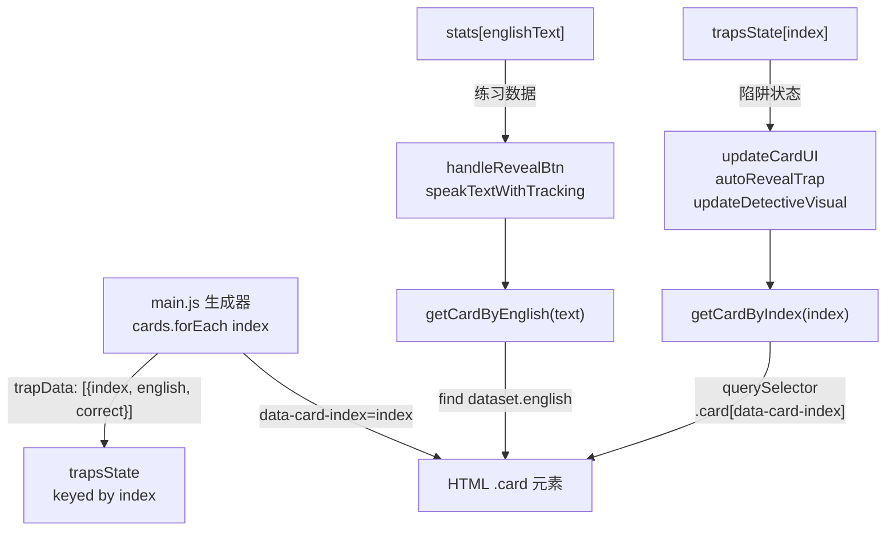

# 🔧 索引位移与数据错配 Bug 修复计划

## 一、Bug 根源分析

### 1.1 `data-card-index` 存在空隙

在 [`js/main.js`](js/main.js:203) 中，`cards.forEach((card, index) => { ... })` 遍历的是**所有** `.card-item`（包括说明框）。当遇到说明框（`.explanation-item`）时，它生成的是 `<div class="explanation-box">`，而**不**是 `.card`。但 `index` 仍然递增。结果：

```
句子卡片 0 -> data-card-index=0
句子卡片 1 -> data-card-index=1
说明框     -> 跳过（不生成 .card）
句子卡片 2 -> data-card-index=3   ← 这里跳过了 index=2！
```

### 1.2 `cards[cardIndex]` 越界访问

在 [`js/templates/generated-js.js:71`](js/templates/generated-js.js:71) 中：
```javascript
const cards = document.querySelectorAll('.card');
```
这仅返回 **3 个** `.card` 元素。调用 `cards[3]` 返回 `undefined`，导致：
- 第三张卡片的 UI 无法更新
- 内容写入了错误的 DOM 节点（因为 `updateCardUI(1)` 操作的是第二张卡片，但本应操作第三张）

### 1.3 定位到的所有 `cards[cardIndex]` 调用点

| # | 函数 | 行号 | 代码 | 风险 |
|---|------|------|------|------|
| 1 | `updateCardUI(cardIndex)` | [`js/templates/generated-js.js:257`](js/templates/generated-js.js:257) | `const card = cards[cardIndex];` | 🔴 越界/错位 |
| 2 | `updateDetectiveVisual(cardIndex)` | [`js/templates/generated-js.js:410`](js/templates/generated-js.js:410) | `const card = cards[cardIndex];` | 🔴 越界/错位 |
| 3 | `autoRevealTrap(cardIndex)` | [`js/templates/generated-js.js:856`](js/templates/generated-js.js:856) | `const card = cards[cardIndex];` | 🔴 越界/错位 |
| 4 | `initPage()` | [`js/templates/generated-js.js:1206`](js/templates/generated-js.js:1206) | `const card = cards[t.index];` | 🔴 越界/错位 |
| 5 | `tryCaptureFirstTry()` | [`js/templates/generated-js.js:177,180`](js/templates/generated-js.js:177) | `.card` 计数 | 🟡 计数偏差 |
| 6 | `forceCapturePartialFirstTry()` | [`js/templates/generated-js.js:206`](js/templates/generated-js.js:206) | `.card` 计数 | 🟡 计数偏差 |
| 7 | `refreshPersist()` | [`js/templates/generated-js.js:1136`](js/templates/generated-js.js:1136) | `cards.forEach` | 🟡 遍历使用 `data-card-index` 尚可，但有风险 |

---

## 二、重构方案

### Phase 1: 添加统一寻址辅助函数

在 [`js/templates/generated-js.js`](js/templates/generated-js.js) 顶部添加两个辅助函数：

```javascript
// ============================================================
//  统一卡片寻址：通过唯一标识查找 DOM 卡片（替代 cards[index]）
// ============================================================

/**
 * 通过英文原文精确查找 DOM 卡片
 * @param {string} englishText - 解码后的英文原文
 * @returns {Element|null} 匹配的 .card 元素，未找到返回 null
 */
function getCardByEnglish(englishText) {
    return Array.from(document.querySelectorAll('.card')).find(c => 
        c.dataset.english && decodeURIComponent(c.dataset.english) === englishText
    );
}

/**
 * 通过 data-card-index 精确查找 DOM 卡片（用于陷阱操作）
 * @param {number|string} cardIndex - 卡片索引
 * @returns {Element|null} 匹配的 .card 元素，未找到返回 null
 */
function getCardByIndex(cardIndex) {
    return document.querySelector(`.card[data-card-index="${cardIndex}"]`);
}
```

> **为什么需要两个函数？**
> - `getCardByEnglish()`：用于 stats 相关操作（TTS、状态恢复），因为 stats 的 key 是英文原文
> - `getCardByIndex()`：用于陷阱操作（`trapsState`、`trapData`），因为陷阱系统使用索引作为 key

### Phase 2: 替换 `cards[cardIndex]` 调用

#### 2.1 `updateCardUI(cardIndex)` — 行 257

```diff
- const card = cards[cardIndex];
+ const card = getCardByIndex(cardIndex);
```

#### 2.2 `updateDetectiveVisual(cardIndex)` — 行 410

```diff
- const card = cards[cardIndex];
+ const card = getCardByIndex(cardIndex);
```

#### 2.3 `autoRevealTrap(cardIndex)` — 行 856

```diff
- const card = cards[cardIndex];
+ const card = getCardByIndex(cardIndex);
```

#### 2.4 `initPage()` — 行 1203-1214

```diff
- const card = cards[t.index];
+ const card = getCardByIndex(t.index);
```

### Phase 3: 消除全局 `cards` NodeList

**删除** [`js/templates/generated-js.js:71`](js/templates/generated-js.js:71) 的：
```javascript
const cards = document.querySelectorAll('.card');
```

然后将剩余引用替换为即时查询：

#### 3.1 `refreshPersist()` — 行 1136

```diff
- cards.forEach(card => {
+ document.querySelectorAll('.card[data-english]').forEach(card => {
```

#### 3.2 `tryCaptureFirstTry()` — 行 177, 180

```diff
- const totalCards = CONFIG.totalSentences || document.querySelectorAll('.card').length;
+ const totalCards = CONFIG.totalSentences || document.querySelectorAll('.card[data-english]').length;
```

```diff
- const allAttempted = Array.from(document.querySelectorAll('.card')).every(card => {
+ const allAttempted = Array.from(document.querySelectorAll('.card[data-english]')).every(card => {
```

#### 3.3 `forceCapturePartialFirstTry()` — 行 206

```diff
- const totalCards = CONFIG.totalSentences || document.querySelectorAll('.card').length;
+ const totalCards = CONFIG.totalSentences || document.querySelectorAll('.card[data-english]').length;
```

### Phase 4: 审计剩余索引操作

#### 4.1 `initDetectiveMode()` — 行 498

```javascript
document.querySelectorAll('.card[data-trap="true"]').forEach(card => {
    const ci = parseInt(card.dataset.cardIndex);
    if (!isNaN(ci)) updateCardUI(ci);
});
```
✅ 已经使用了属性选择器 + 显式 `data-card-index`，无需修改。但内部调用的 `updateCardUI` 现在将使用 `getCardByIndex`。

#### 4.2 `reportTrap()` — 行 431

```javascript
const cardIndex = parseInt(cardElement.dataset.cardIndex);
```
✅ 使用了事件传入的 `cardElement.dataset.cardIndex`，是可靠的。内部调用的 `updateCardUI` 和 `updateDetectiveVisual` 现在将使用 `getCardByIndex`。

#### 4.3 `trapsState` 索引一致性

`trapsState` 使用 `data-card-index` 作为 key，在生成器中与 `trapData` 使用相同的 `index` 来源（`main.js:231`）。因此 trapsState 的索引与 `data-card-index` 始终一致。✅

#### 4.4 `Object.keys(stats)` 遍历 — 行 887, 912

```javascript
for (let key in stats) { ... }
```
✅ 这些遍历仅在 stats 对象上操作，不涉及 DOM 索引，无需修改。

### Phase 5: 回归测试检查清单

- [ ] 无说明框时，所有功能正常（确认不退化）
- [ ] 有说明框时，前三张卡片功能正常（确认修复）
- [ ] 陷阱句（trap）的 catch / auto-reveal 在说明框出现后仍然定位正确
- [ ] TTS 朗读能正确读出对应卡片的文本
- [ ] `reportTrap` 举报功能正确操作目标卡片
- [ ] `refreshPersist`（页面刷新恢复）在所有卡片上正确恢复状态
- [ ] `claimReward` 统计正确（totalSentences 计数准确）
- [ ] 说明框本身不影响卡片逻辑

---

## 三、关键数据流图



## 四、变更文件清单

| 文件 | 变更类型 | 内容 |
|------|----------|------|
| [`js/templates/generated-js.js`](js/templates/generated-js.js) | 修改 | 添加辅助函数、替换所有 `cards[cardIndex]`、消除全局 `cards`、细化选择器 |
| [`js/main.js`](js/main.js) | 无需修改 | 生成器的 `data-card-index` 分配逻辑正确，无需改动 |
